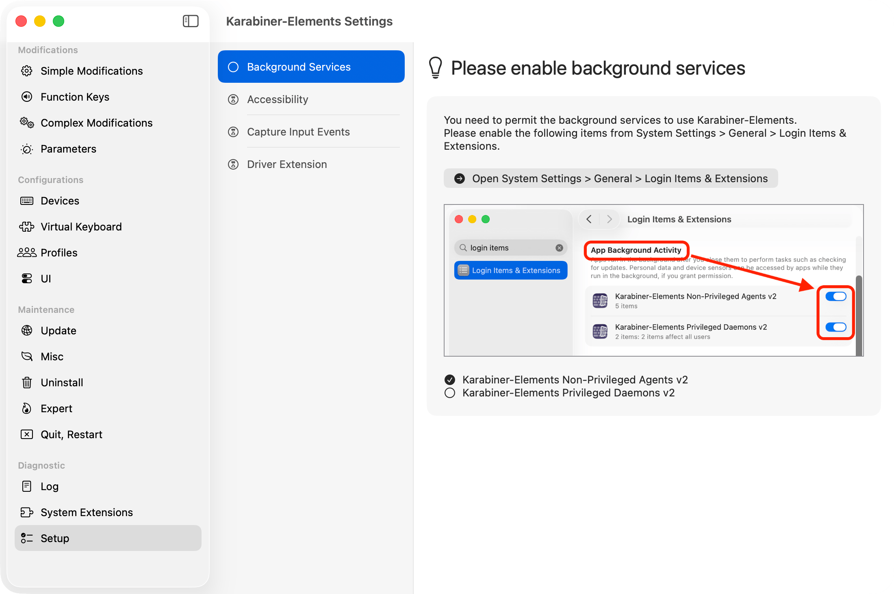
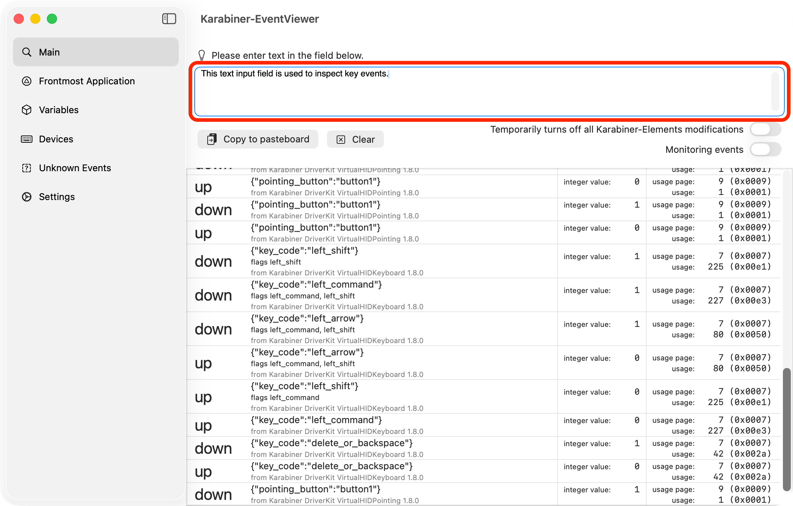
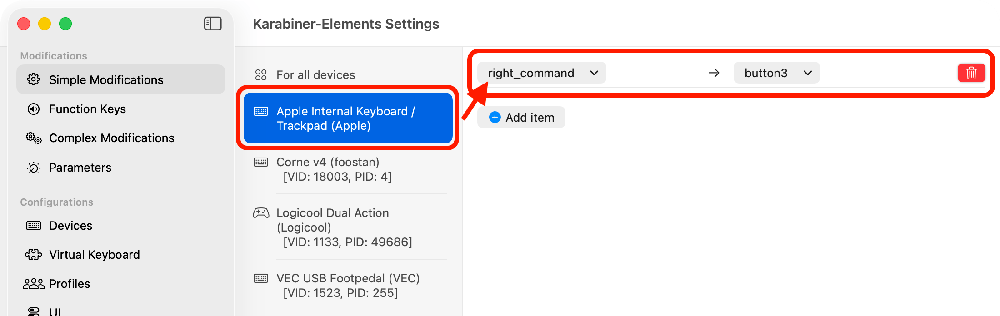

<!-- _class: cover -->

# Karabiner-Elementsを<br>始めよう

<p class="subtitle">Macのキーボードを、自分の手に合わせて育てる</p>

<p class="author">HizumeKazushi / dotfiles実例つき</p>

<!--
講師メモ:
- この発表では、Karabiner-Elementsを初めて触る人が「まず1キー変える」までを目指す。
- 後半では、実際に使っているSpaceレイヤーとdotfiles管理を紹介する。
-->

---

<!-- _class: lead -->

## 毎日触るキーこそ、<br>小さな変更が効く

> 遠いキー、使わないキー、押しづらい組み合わせを、そのまま我慢しなくていい。

Karabiner-Elementsなら、Macに届くキー入力を<br>**自分に使いやすい入力へ置き換えられる。**

<!--
講師メモ:
- ショートカット暗記の話ではなく、物理的なキー配置を自分に合わせる話だと伝える。
- まずはCaps Lockのような、普段あまり使わないキーを変えるだけでもよい。
-->

---

## Karabiner-Elementsでできること

<div class="three">
  <div>
    <div class="big-number">1</div>
    <h3>キーを置き換える</h3>
    <p>Caps LockをFnにするなど、1対1の変更から始められる。</p>
  </div>
  <div>
    <div class="big-number">2</div>
    <h3>条件を加える</h3>
    <p>押し方、アプリ、デバイスによって動作を切り替えられる。</p>
  </div>
  <div>
    <div class="big-number">3</div>
    <h3>新しいレイヤーを作る</h3>
    <p>キーを押している間だけ、文字キーを矢印や数字に変えられる。</p>
  </div>
</div>

<!--
講師メモ:
- 最初からJSONを書く必要はない。
- 1対1の変更はGUI、複雑な条件はComplex Modificationsという段階がある。
-->

---

## 最初に、macOSの権限をそろえる

<div class="columns wide-right">
  <div>
    <ol>
      <li>Karabiner-Elementsをインストール</li>
      <li>Settingsの <strong>Setup</strong> を開く</li>
      <li>表示された項目を順に許可</li>
      <li>キーボード種別を選ぶ</li>
    </ol>
    <p class="compact">背景サービス、アクセシビリティ、入力監視、Driver Extensionが必要。</p>
  </div>
  <div>
    
    <p class="source">出典: Karabiner-Elements公式ドキュメント「Installation」</p>
  </div>
</div>

<!--
講師メモ:
- 現行版ではSettingsのSetup画面が必要な操作を案内してくれる。
- 記号キーが印字と合わない場合はVirtual Keyboardの種類を確認する。
-->

---

## EventViewerで「キーの名前」を知る

<div class="columns wide-right">
  <div>
    <p>設定を書く前に、キーを押してイベントを確認する。</p>
    <ul>
      <li><code>caps_lock</code></li>
      <li><code>left_command</code></li>
      <li><code>japanese_pc_nfer</code></li>
    </ul>
    <p><strong>推測せず、実際のイベントを見る</strong>のが近道。</p>
  </div>
  <div>
    
    <p class="source">出典: Karabiner-Elements公式ドキュメント「EventViewer」</p>
  </div>
</div>

<!--
講師メモ:
- EventViewerは変更後のイベントを表示する。
- 元のイベントを調べたいときは、一時的に変更を無効化するトグルも使える。
-->

---

## 最初の変更は、1対1でいい

<div class="key-flow">
  <kbd>Caps Lock</kbd>
  <span class="arrow">→</span>
  <kbd class="accent">Fn</kbd>
</div>

<div class="columns">
  <div>
    <p><strong>Simple Modifications</strong>を開き、対象キーボードを選ぶ。</p>
    <p>変更元と変更先を選ぶだけで、すぐに試せる。</p>
  </div>
  <div>
    
    <p class="source">出典: Karabiner-Elements公式ドキュメント「Change a key to another key」</p>
  </div>
</div>

<!--
講師メモ:
- dotfilesでは、キーボードに対してcaps_lockをkeyboard_fnへ変更している。
- まずは変更し、EventViewerや普段の操作で結果を確認する。
-->

---

## 複雑さは、必要になってから足す

<div class="compare">
  <div>
    <h3>Simple Modifications</h3>
    <p>キーAをキーBへ置き換える。</p>
    <div class="key-flow">
      <kbd>A</kbd><span class="arrow">→</span><kbd class="accent">B</kbd>
    </div>
    <ul>
      <li>GUIで設定できる</li>
      <li>最初の1歩に向く</li>
    </ul>
  </div>
  <div>
    <h3>Complex Modifications</h3>
    <p>条件を満たすときだけ、動作を変える。</p>
    <div class="key-flow">
      <kbd>Space + K</kbd><span class="arrow">→</span><kbd class="accent">←</kbd>
    </div>
    <ul>
      <li>押し方や変数を使える</li>
      <li>レイヤーを作れる</li>
    </ul>
  </div>
</div>

<!--
講師メモ:
- SimpleとComplexは独立して処理される。
- 初心者はSimpleから始め、欲しい動作を言葉で説明できたらComplexへ進めばよい。
-->

---

## Spaceキーを、押している間だけ別の層にする

<div class="key-flow">
  <kbd>Space</kbd>
  <span class="arrow">+</span>
  <kbd>K</kbd>
  <span class="arrow">→</span>
  <kbd class="accent">←</kbd>
</div>

<div class="steps">
  <div>
    <h3>押す</h3>
    <p><code>space_layer = 1</code> にする。</p>
  </div>
  <div>
    <h3>組み合わせる</h3>
    <p>変数が有効な間だけ、文字キーを別の入力へ変える。</p>
  </div>
  <div>
    <h3>離す</h3>
    <p><code>space_layer = 0</code> に戻す。Space単体は普通の空白。</p>
  </div>
</div>

<!--
講師メモ:
- Spaceを先に押したまま、対象キーを押す。
- to_if_aloneがあるので、単独で押したSpaceは通常どおり空白になる。
-->

---

## 手を大きく動かさず、矢印と数字を入力する

<div class="layer">
  <div class="key"><span class="from">V</span><span class="to">1</span></div>
  <div class="key"><span class="from">C</span><span class="to">2</span></div>
  <div class="key"><span class="from">X</span><span class="to">3</span></div>
  <div class="key"><span class="from">O</span><span class="to">4</span></div>
  <div class="key"><span class="from">A</span><span class="to">5</span></div>

  <div class="key"><span class="from">T</span><span class="to">↓</span></div>
  <div class="key"><span class="from">K</span><span class="to">←</span></div>
  <div class="key"><span class="from">N</span><span class="to">↑</span></div>
  <div class="key"><span class="from">S</span><span class="to">→</span></div>
  <div class="key"><span class="from">H</span><span class="to">Enter</span></div>

  <div class="key"><span class="from">I</span><span class="to">6</span></div>
  <div class="key"><span class="from">,</span><span class="to">7</span></div>
  <div class="key"><span class="from">U</span><span class="to">8</span></div>
  <div class="key"><span class="from">L</span><span class="to">9</span></div>
  <div class="key"><span class="from">.</span><span class="to">0</span></div>
</div>

<p class="layer-note">dotfilesの選択中プロファイル <code>o24</code> にあるSpaceレイヤーの主要マッピング</p>

<!--
講師メモ:
- 実際の配列に合わせたキーなので、一般的なVim配列とは異なる。
- ここで大事なのは正解の配列ではなく、自分の手に合わせてレイヤーを作れること。
-->

---

<!-- _class: code-small -->

## JSONは「入力・条件・出力」で読む

<div class="columns wide-left">
  <div>

```json
{
  "type": "basic",
  "from": { "key_code": "k" },
  "conditions": [{
    "type": "variable_if",
    "name": "space_layer",
    "value": 1
  }],
  "to": [{ "key_code": "left_arrow" }]
}
```

  </div>
  <div>
    <h3>from</h3>
    <p>何を押したか</p>
    <h3>conditions</h3>
    <p>いつ変換するか</p>
    <h3>to</h3>
    <p>何を送るか</p>
  </div>
</div>

<!--
講師メモ:
- JSON全体を暗記する必要はない。
- まずfrom、conditions、toの3点を見つければ、ルールの意図を読める。
-->

---

## プロファイルを分ければ、大きな変更も試せる

<div class="columns">
  <div>
    <h3>選択中: o24</h3>
    <p>文字キーの配置や修飾キーを大きく変更した個人用プロファイル。</p>
    <ul>
      <li><code>A → E</code></li>
      <li><code>D → A</code></li>
      <li><code>Left Command → Backspace</code></li>
      <li><code>Right Shift → Left Control</code></li>
    </ul>
  </div>
  <div>
    <h3>安全に試すコツ</h3>
    <ul>
      <li>普段用と実験用を分ける</li>
      <li>メニューバーにプロファイル名を出す</li>
      <li>一度に全部変えず、少しずつ慣らす</li>
    </ul>
    <p class="compact"><strong>プロファイルは「いつでも戻れる場所」を作る。</strong></p>
  </div>
</div>

<!--
講師メモ:
- o24全体の説明はしない。発展例として、Karabinerで配列自体も設計できることを見せる。
- 初心者には、まずDefaultを残したまま別プロファイルで試す方法を勧める。
-->

---

## 設定をdotfilesに置くと、変更の履歴が残る

<div class="columns wide-left">
  <div class="terminal">
    <span class="prompt">$</span> readlink ~/.config/karabiner<br>
    /Users/apple/ghq/.../dotfiles/karabiner<br><br>
    <span class="prompt">$</span> jq empty karabiner/karabiner.json<br>
    <span class="prompt">$</span> git diff --check
  </div>
  <div>
    <ol>
      <li><code>karabiner.json</code>をGit管理</li>
      <li><code>~/.config/karabiner</code>からリンク</li>
      <li>変更後にJSONと差分を確認</li>
    </ol>
    <p class="compact">別のMacへの移行、変更理由の確認、元に戻す作業がしやすくなる。</p>
  </div>
</div>

<!--
講師メモ:
- assets/complex_modificationsはルール素材で、置いただけでは現在のプロファイルに反映されない。
- 実際に読み込まれる中心はkarabiner.json。
-->

---

## 反映されないときは、読込先を見る

<div class="columns wide-left">
  <div>
    <p>Karabiner-Elementsは通常、<code>karabiner.json</code>の更新を自動で読み込む。</p>
    <p>ただし親ディレクトリやシンボリックリンクを置き換えると、古いJSONを開いたままになることがある。</p>
  </div>
  <div class="terminal">
    <span class="prompt">$</span> lsof -c Karabiner \<br>
    &nbsp;&nbsp;| rg 'karabiner\.json'<br><br>
    <span class="prompt">$</span> karabiner_cli \<br>
    &nbsp;&nbsp;--show-current-profile-name
  </div>
</div>

<blockquote>設定内容だけでなく、どのファイルを読んでいるか確認する。</blockquote>

<p class="source">参考: Karabiner-Elements公式「File locations」およびdotfilesのkarabiner/README.md</p>

<!--
講師メモ:
- 公式ドキュメントにも、親ディレクトリを作り直すとファイル更新を検知できなくなる旨がある。
- 読込先が古ければ、Karabiner-Elementsまたはユーザーサービスを再起動する。
-->

---

<!-- _class: end -->

## まず1キー変えて、<br>使いながら育てよう

<div class="key-flow">
  <kbd>Caps Lock</kbd>
  <span class="arrow">→</span>
  <kbd class="accent">Fn</kbd>
</div>

<div class="steps">
  <div>
    <h3>変える</h3>
    <p>Simple Modificationsで、小さな不満を1つ解消する。</p>
  </div>
  <div>
    <h3>確かめる</h3>
    <p>EventViewerと普段の操作で、意図どおりか確認する。</p>
  </div>
  <div>
    <h3>残す</h3>
    <p>使いやすければdotfilesへ保存し、次の改善につなげる。</p>
  </div>
</div>

<!--
講師メモ:
- 今日の行動として「Caps Lockを何に変えるか」を決めてもらう。
- 完璧な配列を先に考えず、小さく試して育てることを最後に強調する。
-->
