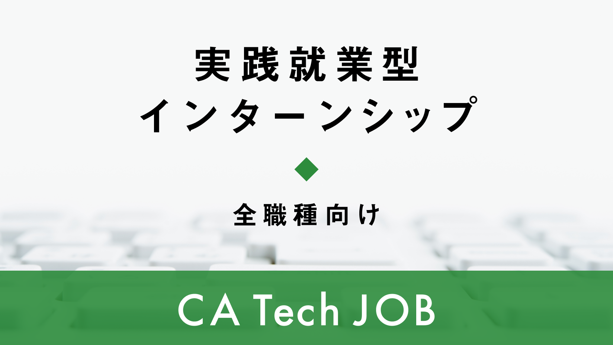
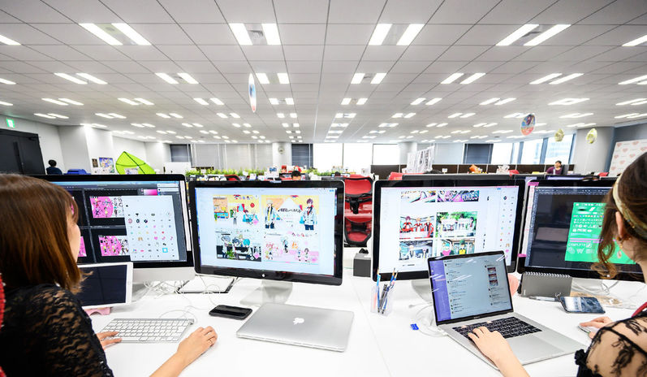

<!-- _class: cover -->
<!-- _footer: '' -->

# 15日間のエンジニアインターンで 学んだこと

実際の開発現場で見えたこと

日詰和志

<!-- 30秒。所属や普段取り組んでいる開発を簡単に自己紹介する。 -->

---

# 今日お話しすること

1. 参加前の目標とインターンの概要
2. 15日間で取り組んだこと
3. フィードバックと学んだこと
4. インターンに参加するときの心構え

<!-- 15秒。発表の流れを簡単に紹介する。 -->

---

# 参加前に立てた目標

- 遊んでいたゲームの**開発体制や実装**を知る
- 他職種との連携を経験し、ゲーム開発の違いを知る
- バックエンドの実務を通じて、将来への道筋を考える

<!-- 40秒。個人開発の実装経験はあったが、実務レベルでの開発経験はなかった。遊んでいたゲームのユーザー体験がどのように支えられているかを知ることも目標だった。 -->

---

# CA Tech JOBとは？

サイバーエージェントの **実践就業型インターン**

- 社員と同じように実務を経験
- メンターによる支援がある
- 今回の参加期間は **15日間**

画像・内容：[サイバーエージェント 公式募集ページ](https://www.cyberagent.co.jp/careers/students/event/detail/id=32004)（2026年11月5日閲覧）

<!-- 40秒。募集内容は年度・コースによって異なる。 -->

---

# 15日間で取り組んだこと

- ゲーム内の施策に関わる機能実装
- ゲームの管理画面の機能追加
- **BigQueryのデータコピー**の実装・検証
- 新規施策への意見出し

<!-- 45秒。それぞれ担当した範囲を、公開可能な範囲で補足する。 -->

---

# BigQueryのデータコピー

**背景**：本番環境のデータを 開発環境で使いたい

開発環境同士で、次の手順を検証

1. テーブルとスキーマを確認
2. コピー用のSQLを作成・実行
3. コピーしたデータを確認

BigQuery

アイコン：[Google Cloud公式アイコンライブラリ](https://cloud.google.com/icons)

<!-- 1分20秒。検証は開発環境間で行った。実際に本番からコピーしたとは断定しない。公開できる範囲で工夫や苦労を補足する。 -->

---

# 目標を行動に落とし込む

## 業務の進め方

- 質問や報連相を早めにする
- タスクの状況を把握する
- 積極的に発言する

## タスクへの向き合い方

- 全体像を理解する
- 進捗を具体的に伝える
- タスクを文書にまとめる

<!-- 50秒。Growthシートでは、工数見積もりを共有すること、1日1回以上の発言、任されたタスクを自分なりに文書化することを目標アクションに挙げていた。目標であり、すべて達成したと断定しない。 -->

---

# 中間フィードバック

## 評価されたこと

- 不明点を質問し、PRでのやり取りができていた
- 交流が増え、意見を伝えられていた

## 後半に向けた課題

- さらに積極的に意見を出す
- 設計に加えて、コードを書く力を伸ばす

<!-- 55秒。private関数をロジックの取りまとめだけに使わないことなど、コードの考え方について助言を受けた。 -->

---

# 最終フィードバックと今後の課題

## 成果として評価されたこと

- 自分から行動し、トレーナー以外とも連携できた
- 障害対応に自ら関わろうとした
- タスクの成果は、期待を超えたと評価された

**今後の課題：** 設計の強みを生かし、コードを書く力を伸ばす

<!-- 1分。成果はトレーナーの評価として紹介する。設計は良いという評価と、コードを書く力はさらに伸ばせるという助言を対にして話す。 -->

---

# 学んだこと① 開発環境と安全性

**動くだけでなく、運用しやすさと安全性も考える**

- 本番環境と開発環境には異なる役割がある
- データを扱う前に、環境・テーブル・スキーマを確認
- 開発環境同士でコピーを検証し、結果を確認

<!-- 1分。参考資料の「環境ごとの役割設計」「運用しやすく安全な環境」という学びを、データコピーの例と結びつけて話す。 -->

---

# 学んだこと② チームで読むコード

**実装した人以外にも、読みやすいコードを考える**

設計は評価された一方、コードを書く力には伸びしろがある

- private関数を、単に処理をまとめるためだけに使わない
- 自分にとっての「適切なコード」を考え続ける

<!-- 55秒。private関数の使い方は中間フィードバックの例。常に使わないという意味ではなく、単にロジックをまとめる目的だけで作る必要はないという助言。 -->

---

# 学んだこと③ 職種を越えた連携

## メンテナンス時の動き

他職種と連携しながら、 バグの特定や修正を進める

**周囲と連携する時間も開発の一部**

参考写真：[公式オフィス紹介](https://www.cyberagent.co.jp/en/sustainability/office/) ※実際の配属先を示すものではありません

<!-- 55秒。印象に残ったやり取りを、話せる範囲で補足する。 -->

---

# インターンに参加するときの心構え

- 分からないことは、抱え込まずに相談する
- 目の前の作業だけでなく、背景や目的にも目を向ける
- フィードバックを受け止め、次の行動に生かす

後輩に向けたメッセージ

<!-- 45秒。現場での学びを踏まえた後輩への提案。実体験と結びつく具体例があれば補足する。 -->

---

# 伝えたいこと

**現場では技術だけでなく、 チームの仕事の進め方も学べる**

目標を立て、行動し、フィードバックから次の課題を見つける

興味がある人は、募集内容を調べてみよう

<!-- 1分。参加前の不安や、自分にとって特に大きかった学びを言葉で補足する。 -->
