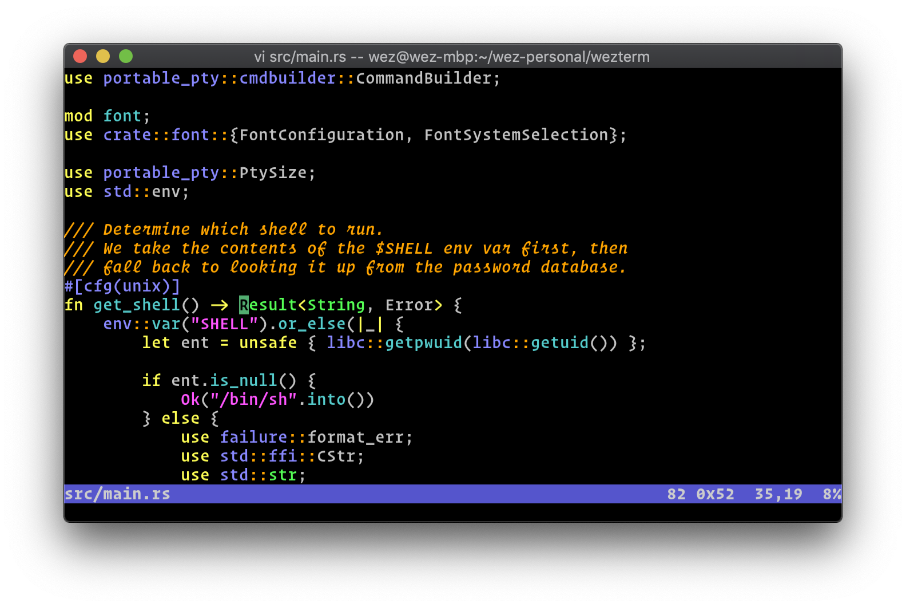
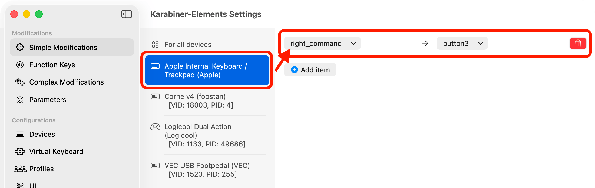
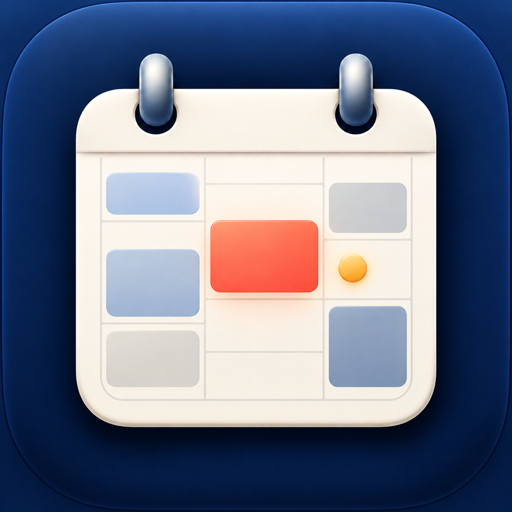

<!-- _class: cover -->
<!-- _footer: '' -->

# 私の開発環境

普段使っているツールと設定

---

# 目次

1. 開発環境の全体像
2. ターミナルとエディタ
3. 操作と設定の管理
4. ブラウザとタスク管理

---

# 開発環境の全体像

## 開発する

WezTerm → Herdr → Zsh

↓

Nixvim ／ Codex

移動・Git操作：ghq・fzf・zoxide・Lazygit

## 調べる・予定を確認

Ardia ／ Muse

Notion ↔ TimeBlocker

カレンダー → TimeBlocker

入力：Karabiner-Elements ／ 設定管理：Nix・Home Manager・dotfiles

---

# WezTerm：作業するターミナル

## 普段の操作

タブとペインで作業画面を分ける

新しいタブではログインZshが開く

## 操作例

`Cmd + t`：新しいタブ

`Ctrl + z`：ペインを拡大・復元

画面例：[WezTerm公式](https://wezterm.org/)

---

# ZshとStarship：コマンド入力

- **Zsh**：コマンドを入力するシェル
- 入力中に履歴候補を表示し、構文をハイライト
- 入力済みの文字に一致する履歴を上下キーで検索
- **Starship**：プロンプトに時刻・ディレクトリ・Gitブランチを表示

---

# WezTermとHerdrの役割

| | WezTerm | Herdr |
| --- | --- | --- |
| 役割 | ターミナルのウィンドウ・タブ | 開発作業のセッション |
| 操作 | ターミナルの画面を切り替える | プロジェクト単位のWorkspaceを使う |

シェルから `herdr` を起動し、デタッチ後は再接続できる。

Herdr内のZshからNixvimやCodexを使う。

PCやHerdrサーバーの再起動時は、元のプロセスは終了します。

---

# Herdr：作業をプロジェクトごとに整理

**Workspace → Tab → Pane** の順に作業を分ける

| 単位 | 使い方の例 |
| --- | --- |
| Workspace | プロジェクトごとに分ける |
| Tab | エージェント・サーバー・テストなどの用途 |
| Pane | 個々のプロセスを表示 |

`Ctrl + b` → `q` でデタッチし、`herdr` で再接続。

---

# コードを書く：NixvimとCodex

**Neovimの設定をNixvimで管理**

- 補完・検索・LSP・フォーマットを設定
- Go、TypeScript、Pythonなどに対応
- `Space` → `e` でファイル一覧を開く
- `Space` → `/` でプロジェクト内を検索
- **Codex**：Herdr内で使うコーディングエージェント

キー表記は順番に入力する操作です。

---

# 移動とGit操作

## プロジェクトへ移動

`ghq` でリポジトリを管理

`cproj` で `fzf` の一覧から選択

`zoxide` は `cd` に統合

## Gitを操作

`Lazygit` で操作

`delta` で差分を表示

`cproj` の選択時にも Gitの状態をプレビュー

---

# ghq・fzf・zoxide：移動を助ける

- **ghq**：Gitリポジトリを決まった場所にまとめる
- **fzf**：候補をあいまい検索して選択する
- **cproj**：ghqの一覧をfzfで選び、選んだ場所へ移動
- **zoxide**：訪問したディレクトリへの移動を補助

この環境ではzoxideを `cd` に統合しています。

---

# Lazygitとdelta：Gitの状態と差分

**Lazygit**：ターミナル上でGitを操作する画面

- ファイルを選んでstage・unstage、コミットなどを操作
- `n / t / k / s` で上下左右に移動するよう設定

**delta**：Gitの差分を見やすく表示

- 行番号を表示し、差分間の移動を有効化

---

# キー操作：Karabiner-Elements

**macOSのキー入力をカスタマイズ**

- o24配列に合わせてキーを設定
- `Space + w` でWezTermを呼び出す

[公式の画面例](https://karabiner-elements.pqrs.org/docs/manual/configuration/configure-simple-modifications/)（実際の設定とは異なります）

---

# Nix・Home Manager：設定をまとめる

- **Nix**：パッケージや設定を定義する仕組み
- **Home Manager**：ユーザー環境をNixで管理
- **Nixvim**：Neovimの設定やプラグインをNixで定義
- 設定は `home-manager switch --flake .#apple` で反映

以前のHome Manager generationに戻すこともできます。

---

# 環境を管理する：Nix + dotfiles

| 管理方法 | 対象 |
| --- | --- |
| Nix + Home Manager | Zsh、CLIツール、Nixvimなど |
| シンボリックリンク | WezTerm、Karabinerなどの設定 |
| 別の手段 | GUIアプリや言語ランタイム |

`dotfiles check` で設定とリンクを検証し、 `dotfiles doctor` で読み込み先などを診断。

---

# Ardia：普段使うブラウザ

**Arcライクなブラウザ**

- WebKitとChromiumを切り替えて使える
- 開発中のWebページを異なるエンジンで確認できる

---

# Muse：AIエージェントによるタスク管理

**Moodle・Googleカレンダー・メールなどの情報**

↓

**MuseがNotionにタスクを自動作成・管理**

NotionのタスクはTimeBlockerからも確認できる。

---

# TimeBlocker：予定とタスクを確認

**macOSのメニューバーから開くアプリ**

- 予定とNotionのタスクを一覧表示
- 予定追加・タスク追加と完了
- 予定の開始やタスクの期限を通知

Notionは約60秒ごとに同期。通知には期限時刻の設定が必要。

TimeBlockerのアプリアイコン

---

# まとめ

- **WezTerm → Herdr → Zsh**：開発作業の実行環境
- **NixvimとCodex**：コード編集とエージェントによる開発
- **Nixとdotfiles**：ツールや設定を管理する
- **Ardiaとタスク管理ツール**：調べることや予定の確認を支える

参考：[dotfiles](https://github.com/HizKz/dotfiles) ／ [TimeBlocker](https://github.com/HizKz/TimeBlocker)

---

<!-- _class: closing -->
<!-- _footer: '' -->

# ありがとうございました
